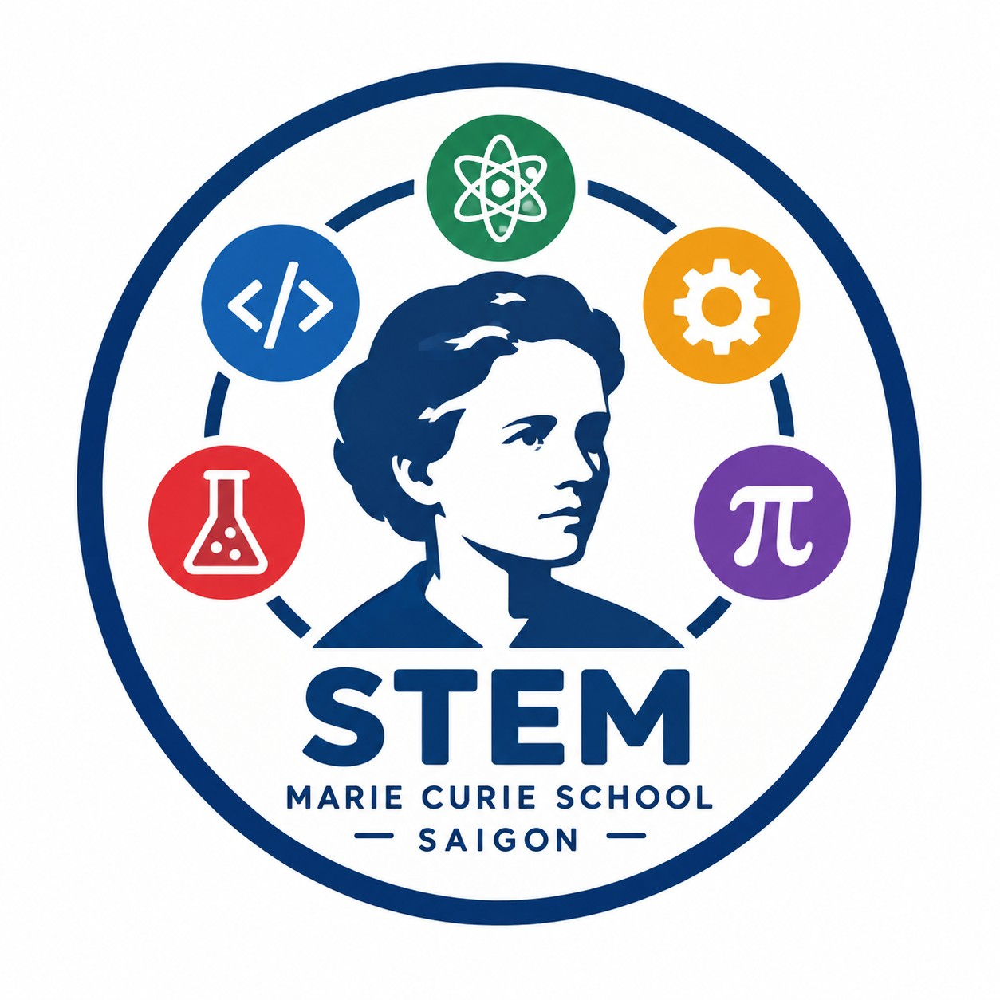

### Welcome to Marie Curie STEM

Here we host and save some of our projects, for collaboration and preservation. Please expore!

- [Yolo UNO](https://github.com/marie-curie-stem/yolo-uno)
- [ESP8266 projects](https://github.com/marie-curie-stem/esp8266)
- [Scratch](https://github.com/marie-curie-stem/Scratch)
- [T100 robot car](https://github.com/marie-curie-stem/T100)
- [OhStem](https://github.com/marie-curie-stem/ohstem)

<!--

**Here are some ideas to get you started:**

🙋‍♀️ A short introduction - what is your organization all about?
🌈 Contribution guidelines - how can the community get involved?
👩‍💻 Useful resources - where can the community find your docs? Is there anything else the community should know?
🍿 Fun facts - what does your team eat for breakfast?
🧙 Remember, you can do mighty things with the power of [Markdown](https://docs.github.com/github/writing-on-github/getting-started-with-writing-and-formatting-on-github/basic-writing-and-formatting-syntax)
-->
